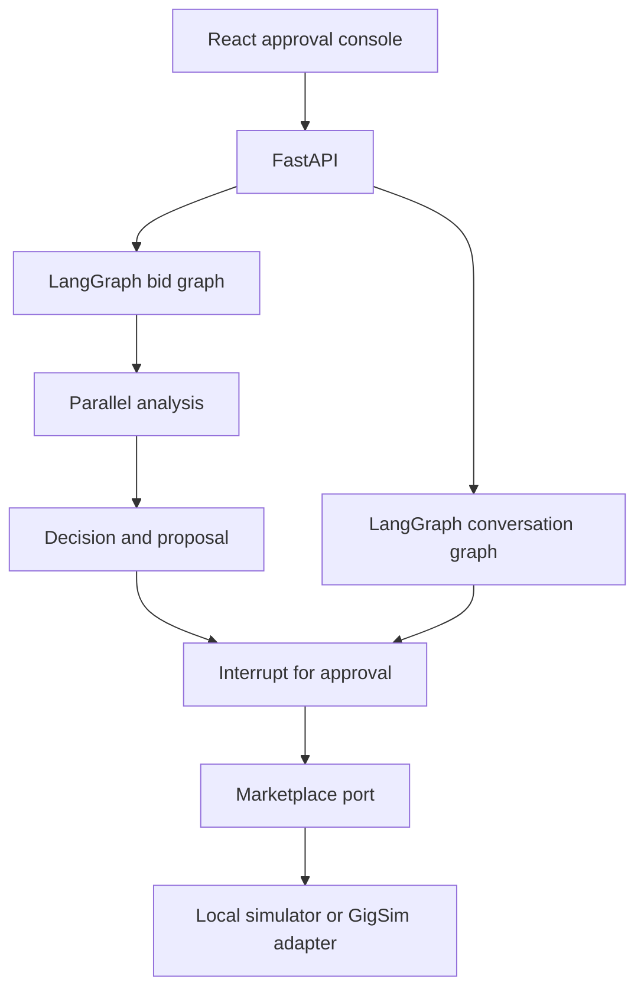

# GigBid — evidence-first freelancer intelligence

An original, from-scratch Assignment II implementation with a React/TypeScript interface, FastAPI API, LangGraph bid/conversation state machines, approval interrupts, portfolio retrieval and three MCP servers. The default demonstration is completely local and uses **synthetic examples**.

**Updated interface:** navigation now runs across the top in a sticky horizontal bar. The layout uses the full screen width and includes a **Compact view / Comfortable view** toggle beside the account controls; the selection is remembered on the device. Mobile navigation scrolls horizontally without covering the content.

**Priority 1 update:** authorized CSV ingestion, multi-source deduplication and provenance, PDF/Markdown portfolio ingestion, optional real SentenceTransformer embeddings with Chroma persistence, CPU cross-encoder reranking, configurable Ollama proposal writer, and independent-gold retrieval metrics are now available. These optional neural/model paths require installed weights and have **not** yet been benchmarked on real data. Follow [Priority 1 setup](docs/PRIORITY1_SETUP.md).

**Priority 2 update:** the bidding and conversation graphs now use actual official MCP ClientSession transports for risk, portfolio matching, pricing and approved writes (agent-scoped allowlists). LangGraph `Send` runs analysis branches in parallel; V8 retrieval is a bounded corrective LangGraph. SQLite style/outcome memory has explicit promotion rules and a Settings UI delete action. See [Combined Priority 1+2 release notes](docs/PRIORITY1_2_RELEASE.md) for what still needs external access and production integration.

> **Submission status: functional development build, not a full rubric-compliant submission.** The supplied archive contains no executable GigSim service or gold-labelled dev set. No Kaggle data, external Upwork account, local LLM, actual neural embeddings, cloud deployment, client hire outcomes or review panel were available during this build. See [requirements gap report](docs/REQUIREMENTS_AND_GAPS.md). Do not submit this as if those items had been completed.

## Quick start

Requirements: Python 3.11+, Node 20+. From the `gigbid` directory:

```bash
python -m pip install -e '.[test]' langgraph-checkpoint-sqlite
make test
make eval
make dev
```

In another terminal:

```bash
cd apps/web
npm install
npm run dev
```

Open **http://localhost:5173**. Reviewer token: `demo-reviewer-token` (local development only). Set `GIGBID_API_TOKEN` before exposing the application. Use Settings to select AI, Web or Analytics persona; open Job inbox; analyze job `j100` to see an approval gate; edit, approve or reject. `j102` and `j107` demonstrate risk screening. The Messages screen exposes the separate conversation graph.

## Why these pieces exist



Parallel analysis = structured Job Analyst, Risk Assessor and Fit Matcher. The bid graph has bounded critique and a claim verifier before pausing. Every send is guarded by a human approval; an edited draft is checked again. Marketplace writes carry deterministic idempotency keys, recorded in SQLite with an append-only audit table.

## Measured retrieval baseline — synthetic fixtures only

Six comparison configurations are executable using `make eval`. Their numbers are written to [`evals/results/synthetic_retrieval.json`](evals/results/synthetic_retrieval.json) on every run. This is a deliberately tiny corpus (8 jobs, 6 evidence items) and not a neural embedding/RAG benchmark.

| Configuration | Recall@5 | MRR | nDCG@10 |
|---|---:|---:|---:|
| V0 TF-IDF | 1.00 | 1.00 | 1.00 |
| V1 requirement decomposition | 1.00 | 1.00 | 1.00 |
| V2 BM25 + TF-IDF RRF | 1.00 | 1.00 | 1.00 |
| V3 lexical overlap rerank | 1.00 | 1.00 | 1.00 |
| V4 outcome promotion | 1.00 | 0.90 | 0.9262 |
| V8 corrective retrieval graph | 1.00 | 1.00 | 1.00 |

**Interpretation:** with so few eligible evidence items, Recall@5 saturates. Outcome boosting hurt ranking quality. V2 is the current configurable default; it is not justified as the best neural RAG variant by this fixture alone.

## Code map

- `agent/graphs/`: two distinct StateGraph workflows and actual approval interrupts.
- `agent/marketplace_port.py`: local simulated port and unverified external GigSim REST adapter; Upwork is safely unavailable until OAuth is implemented.
- `agent/schemas.py`: Pydantic agent handoffs.
- `rag/`: reproducible lexical retrieval variants and conservative claim checks.
- `mcp_servers/`: Portfolio, Marketplace and Workspace official Python MCP SDK servers; start with `python -m mcp_servers.portfolio.server`, etc.
- `data/synthetic.py`: all offline demo fixtures, including independently authored mini evaluation labels.
- `apps/api/` and `apps/web/`: backend routes and professional responsive frontend.
- `evals/`: comparison runner and generated measured results.
- `tests/`: unit, integration and MCP contract smoke tests.

## Safety, scope, and academic honesty

No Upwork scraping, account automation, external sends or invented client outcomes occur. Offline jobs and projects are synthetic. The GigSim adapter's endpoint mapping must be checked against the actual instructor simulator before connecting it. Neural model calls are **optional and unverified on real data**; multi-user identity isolation is not implemented, and a password-like demo token is not production authentication. Review [`docs/REQUIREMENTS_AND_GAPS.md`](docs/REQUIREMENTS_AND_GAPS.md) before grading. Live URLs, public traces, demo GIF, recorded video, third-party MCP connection and published MCP package are not claimed.
