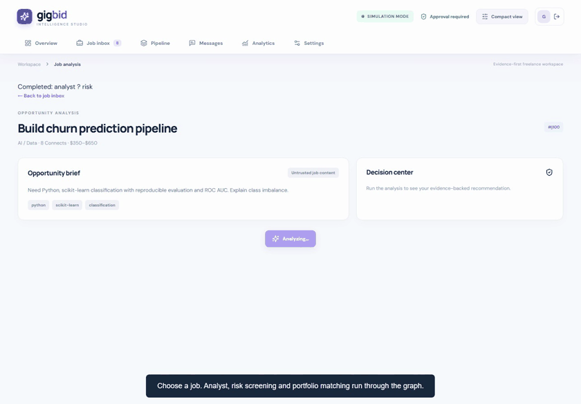
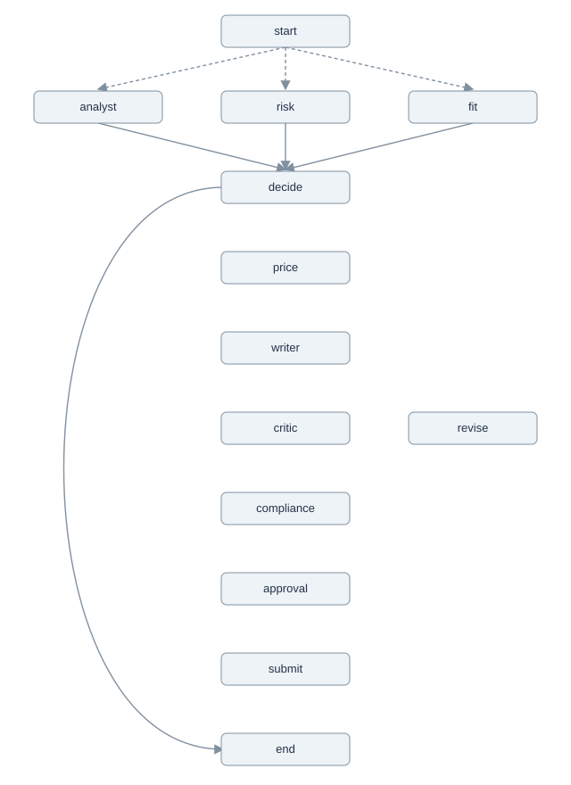
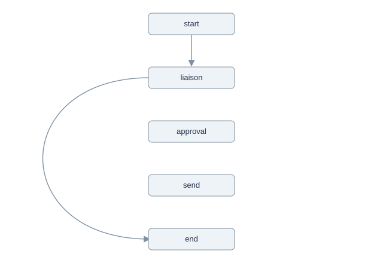

# GigBid - evidence-first freelancer intelligence



GigBid analyses freelance opportunities, maps requirements to portfolio evidence,
drafts proposals and client replies, and pauses for reviewer approval before any
send. React/TypeScript, FastAPI, handwritten LangGraph graphs and official MCP
servers form one working application.

**Current status:** tested local development build with real optional Ollama
inference and embedding experiments. It is not a completed rubric-compliant
submission. Read [current completion status](docs/COMPLETION_STATUS.md) for both
implemented features and unfinished work. Missing instructor data, hosted
services and public publications are never represented as completed.

## Run on Windows

Python 3.12 is the deployment target; this completion pass was tested with
Python 3.14 because the supplied 3.12 virtual environment pointed to a missing
interpreter. Exact executed package versions are in
[environment.json](evals/results/environment.json). Use Node 20 or newer.

```powershell
python -m venv .venv-current
.\.venv-current\Scripts\python.exe -m pip install -e ".[test,neural-lite,report]" langgraph-checkpoint-sqlite
.\.venv-current\Scripts\python.exe -m uvicorn apps.api.main:app --host 127.0.0.1 --port 8000
```

In another terminal:

```powershell
cd apps/web
npm.cmd ci
npm.cmd run dev
```

Open http://localhost:5173. The local fixture uses `demo-reviewer-token`.
Production refuses that token: set a private `GIGBID_API_TOKEN` and put the actual
reviewer credential only in the private Classroom comment. Do not commit it.

Choose a persona in Settings, analyse a job in the inbox, inspect its evidence,
and edit/approve/reject. Pipeline reopens saved approvals after refresh.
Messages uses a separate approval graph, including interview slots from Workspace
MCP and hourly negotiation drafts. All default marketplace records are synthetic.

## Real local open-model profile

Start Ollama, download the explicit models, then enable the backends:

```powershell
.\.venv-current\Scripts\python.exe scripts/prepare_open_models.py
$env:GIGBID_LLM_BACKEND='ollama'
$env:GIGBID_RAG_BACKEND='ollama-vector'
$env:GIGBID_MCP_TIMEOUT='120'
.\.venv-current\Scripts\python.exe -m uvicorn apps.api.main:app --host 127.0.0.1 --port 8000
```

The writer model is configured in `agent/config.yaml`; the small local profile
is a runnable starting point, not a demonstrated best-quality choice. Router,
risk and critic currently contain deterministic rules; their configured model
names do not mean those nodes make LLM calls. Template/lexical mode remains
available for a fast demonstration. `ollama-vector` uses real nomic embeddings
and persistent sqlite-vec cosine search. Optional SentenceTransformer/Chroma
and cross-encoder paths require `.[neural]` and their downloaded weights.

## Architecture





`python -m scripts.render_graphs` exports these from the actual graph objects.
Analyst, Risk and Fit use parallel `Send` branches. The bid graph has bounded
critique, content verification, compliance and an approval interrupt. The
conversation graph has its own interrupt. Agent-scoped MCP allowlists restrict
tool access; marketplace writes use deterministic idempotency keys and audit rows.

Job state, execution traces and promoted memory are separate. Shared persistent
paths make API and MCP subprocesses use the same marketplace database. The
SQLite run index restores discoverability after refresh. PostgresSaver is
optional; Postgres Store memory and multi-user tenancy are still unfinished.

## Executed evidence

- [Lexical retrieval comparison](evals/results/synthetic_retrieval.json): the
  authored micro-corpus saturates Recall@5; outcome weighting reduces ranking
  quality. These results do not establish neural superiority.
- [Real Ollama embedding experiment](evals/results/ollama_retrieval.json): inspect
  the declared cache policy, query count and per-persona breakdown.
- [Open-model comparison](evals/results/open_model_comparison.json) and
  [limited smoke run](evals/results/open_model_smoke.json): raw outputs, measured
  latency, tokens and truncation status; no calibrated quality or client outcomes.
- [System and adversarial probes](evals/results/synthetic_system.json), with
  [original failures](evals/results/synthetic_system_before.json) preserved.
- [Python test report](evals/results/tests.xml) and
  [Playwright results](evals/results/playwright.json). These are executed local
  checks; CI definitions are not a claim that remote CI has already passed.

No reply/hire rates, calibrated judge scores or hidden-test results are invented.
See [evaluation instructions](docs/EVALUATION.md) for supplied dev-label formats
and reproducible commands. A verifier rejection is not an oracle truth label.

## Validate and prepare submission

```powershell
.\.venv-current\Scripts\python.exe -m pytest -q
.\.venv-current\Scripts\python.exe -m evals.runners.compare_retrieval
.\.venv-current\Scripts\python.exe -m evals.runners.evaluate_system
.\.venv-current\Scripts\python.exe -m evals.runners.check_gates
.\.venv-current\Scripts\python.exe scripts/build_report.py
.\.venv-current\Scripts\python.exe scripts/package_submission.py
```

From `apps/web`, run `npm.cmd run build`, `npx.cmd playwright install chromium`
and `npm.cmd run test:e2e`. `npm.cmd run record:demo` records the real local
workflow with explanatory captions; it creates no fictitious client outcomes.
The current recording is silent and uses clearly identified synthetic data.

- [Submission checklist](docs/SUBMISSION_CHECKLIST.md)
- [Technical article draft](docs/TECHNICAL_WRITEUP.md)
- [Three-minute demo plan](docs/DEMO_SCRIPT.md)
- [Installable Portfolio MCP](mcp_servers/portfolio/README.md)
- [Deployment preparation](docs/DEPLOYMENT.md)
- [AI usage disclosure](docs/AI_USAGE.md)

The report, recording and source bundle are generated beneath `output/`.
The older `docs/GigBid_Engineering_Review.pdf` is historical and superseded.
The Render blueprint is prepared but not deployed; it needs an account and a
paid persistent disk. Public app, demo, article and trace URLs must be verified
before one final Classroom submission. The current deadline needs confirmation.
